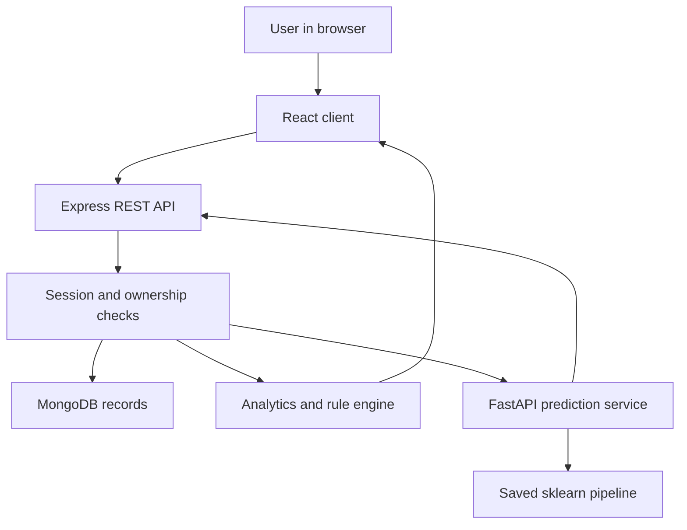
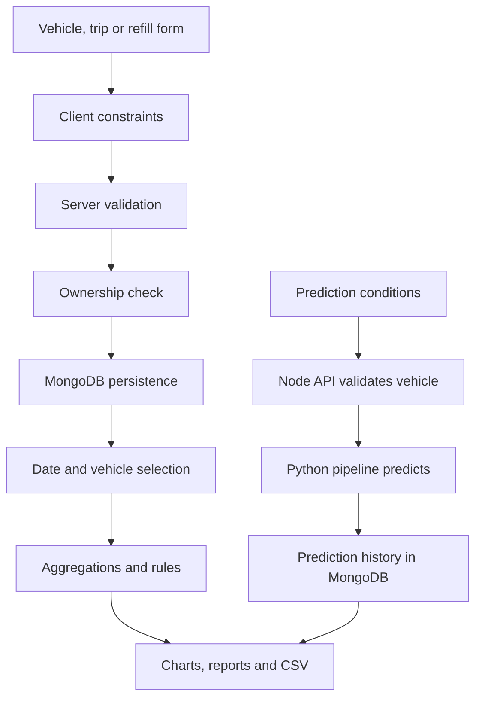

# System architecture

The React client talks only to the Express API through same-origin `/api` requests. The API authenticates users and enforces owner-scoped database queries. MongoDB stores accounts, hashed sessions, vehicles, trips, refill logs and prediction snapshots. A separate FastAPI service loads a trusted bundled scikit-learn pipeline. It has no user database access.

## Data flow

## Security boundary
The browser receives public account fields, never password hashes or session token hashes. Cookies are HttpOnly and SameSite=Strict; Secure is enabled in production. Mutation requests with a browser Origin must match CLIENT_ORIGIN; JSON is required for nonempty bodies. CORS allows only that origin. Authentication is rate-limited, body size is 100 KB, Helmet sets security headers and no-store protects API response caching. Input identifiers and filter keys are validated; Mongo query operators are not accepted from request objects.

Every private record query is scoped to owner. Parent vehicle ownership is checked for new records and prediction requests. Foreign IDs return 404. Vehicle deletion is rejected while dependencies exist. Editing/deleting trips unlinks prediction actuals to prevent stale comparisons; prediction input/result snapshots are preserved until separately deleted.

## Deployment
The supported package is a local multi-service application. Production needs Node, MongoDB and Python hosting with private service networking and HTTPS. The provided local Compose binds ports to loopback, uses MongoDB authentication and a persistent volume. MongoDB/Python cannot be deployed on the previous static Sites hosting environment. No full-stack live URL is claimed.
