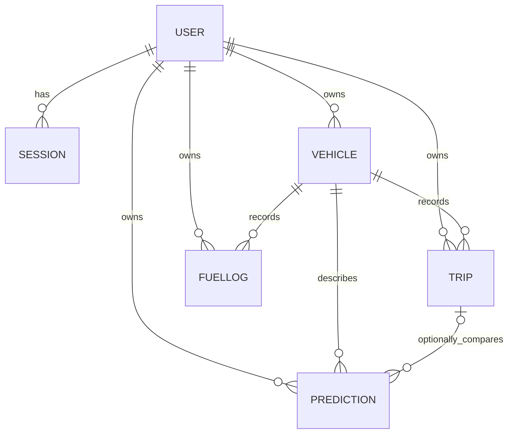

# Database design

All models have createdAt/updatedAt timestamps. API validation is performed by Zod; Mongoose provides typed schemas, numeric bounds where applicable, required fields, enums and database indexes.

| Collection | Fields | Relationships / indexes |
|---|---|---|
| users | name, normalised unique email, passwordHash (excluded by default), settings | Unique email |
| sessions | user, SHA-256 tokenHash, expiresAt | User ref, unique tokenHash, expiry TTL index |
| vehicles | owner, name, optional registration, type, make/model/year, fuelType, engineL, weightKg, expectedMileage, odometer, notes | Owner ref and owner index |
| trips | owner, vehicle, date, optional start/end odometers, distanceKm, fuelL, fuelSource, pricePerL, optional duration/speed/idle/conditions/notes | Owner+date+vehicle index; unique owner+vehicle+date+distance+fuel duplicate key |
| fuellogs | owner, vehicle, date, litres, pricePerL, odometer, fullTank, optional station/notes | Owner+date+vehicle; unique vehicle+date+odometer |
| predictions | owner, vehicle, inputs, result, optional trip and actualMileage | Owner+createdAt; owner/vehicle refs |

Recommendations are computed from selected stored records, so stale rule outputs are not persisted. Refill totals and trip efficiency are derived rather than stored redundantly. Trip dates use validated ISO calendar strings for explicit local calendar-day filtering; timestamps use MongoDB dates. A vehicle's profile odometer is a manual reference, not an automatically inferred live reading.

MongoDB standalone operation is supported. Dependency-changing operations are ordered, not multi-document transactions; a process failure during unlink/delete can leave a harmless missing actual link but no cross-user access. For high-concurrency production use, add a replica set and transactions around dependent writes/deletion to close concurrency races. Vehicle deletion currently rejects dependencies; it never silently cascades them.
